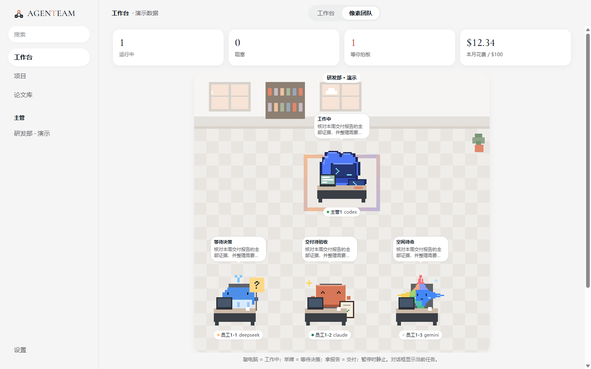

<div align="center">


# AgenTeam

**Focus your attention on valuable things.**

Say one sentence and walk away. A team of AI agents you named does the whole job and hands it back with evidence.

[中文](README.md) · **English**

[Quick start](#quick-start) · [How it works](#how-it-works) · [Features](#features) · [Guide (中文)](docs/guide.md) · [Direction (中文)](docs/v0.6-direction.md)

[](https://github.com/micsnq2yoma-lgtm/AgenTeam/stargazers) [](https://github.com/micsnq2yoma-lgtm/AgenTeam/actions/workflows/ci.yml)    



</div>

> The app UI is currently Chinese only. This page is a translation of the Chinese README.

## How it works

| ① Say one sentence | ② A lead takes over | ③ An employee does the work | ④ One-page result |
| --- | --- | --- | --- |
| A router hands it to the best-suited lead | Understands intent, writes acceptance criteria; big jobs get a plan for your approval first | Claude Code / Codex, already logged in on your machine, works start to finish | Evidence for every criterion; the lead signs off and gives you one page |

Leads and employees are named by you; nothing is preset. Decisions that need you become cards, and can be pushed to Feishu while you are away.

## Who it is for

- ✅ You want to hand off whole jobs (research, writing, organizing) instead of steering a chat line by line
- ✅ You already have Claude / Codex subscriptions and want them to divide the work
- ✅ You want every conclusion backed by evidence and independently checked
- ❌ Not a multi-user SaaS: one install per machine, data stays local

## Features

| | |
| --- | --- |
| 🧭 **Router & leads** One sentence goes to the right lead; big jobs get a plan and wait for your nod | ✅ **Evidence & verification** Structured acceptance, an independent checker, rework and depth limits |
| 👀 **Watching** Long tasks watch themselves and call you on a schedule or an incident | 🧠 **Memory** Cross-project memory, tidied and committed while idle |
| 🤖 **Multi-model** Subscriptions (Claude / Codex) or any API model, chosen per employee, with price estimates | 🔌 **Tool servers (MCP)** One-click catalog or custom, scoped per employee |
| ✉️ **Mail** Read-only; saves reply drafts, never sends | 📚 **Paper library** arXiv / DOI / PDF intake, full-text search, usable by employees |
| 💬 **Feishu** Long connection, no public address; card buttons act directly | 🎨 **Pixel office** A pixel employee per model; office / court skins |

## Quick start

Windows 11, Node 24.11+, pnpm 9.15+, Git. Install and log in first:

- Claude Code: `npm i -g @anthropic-ai/claude-code`, then run `claude` to log in (used by leads, router and checker)
- Codex (optional): `npm i -g @openai/codex`, then `codex login`

```powershell
git clone https://github.com/micsnq2yoma-lgtm/AgenTeam.git
cd AgenTeam
node scripts\install.mjs
```

The script checks the environment, installs and builds, runs Paperclip's first-time setup, starts everything, installs the team-layer plugin and enables autostart (10+ minutes). Then open <http://127.0.0.1:3100> and click **+** next to “Leads” in the sidebar to create your first lead and employee.

Each machine is independent: its own subscriptions, API keys and data.

## Updating

Settings → General → Version & updates: check, update now, or update daily (only when no employee is working). From the command line:

```powershell
node scripts\update.mjs --check   # is there a new version
node scripts\update.mjs           # back up → stop → pull main → incremental build → start → health check
```

A version that fails to start is rolled back automatically. The database is not restored automatically; backups are in `~/.agenteam/backups/` (5 kept). Every PR and main run unit tests and a full build on GitHub Actions (Linux + Windows).

## Architecture

```
              ┌──────────── only :3100 is exposed ────────────┐
 you / Feishu ─▶│  Paperclip (tasks, runs, UI; vendor/paperclip)  │
              │   ├─ team-layer plugin: acceptance / checks / watching / memory │
              │   └─ /agenteam/api ─▶ local service :3200 (localhost only) │
              └────────────────────────────────────────────────┘
                     router · settings · team MCP · mail · papers · Feishu
                              │
                 employees: local Claude Code / Codex / API models
```

| Directory | Contents |
| --- | --- |
| `apps/console/` | Local service: router, IM, settings, memory, team wizard, hiring approval, team MCP |
| `plugins/team-layer/` | Paperclip plugin: rework / hop limits, cards, structured acceptance, independent checks, watching, memory tidy-up |
| `plugins/im-feishu/` | Feishu channel |
| `vendor/paperclip/ui/src/agenteam/` | Workbench and other pages inside the Paperclip UI |
| `packages/` | `shared` types · `skins` · `pixel-office` renderer |
| `skills/` `packs/` | Lead / employee / memory skill packs; blank team templates |
| `scripts/` | Start, install, update, acceptance scripts, localization tools |

**Renamed from Agentself.** Directories, API paths, env vars and the data directory are all `agenteam` now (`~/.agenteam`, `/agenteam/api`, `AGENTEAM_*`). Existing installs migrate on the first start after updating: `~/.agentself` is renamed to `~/.agenteam`, old `AGENTSELF_*` variables are still honored, and agent metadata and per-agent `.agentself` folders are converted. Nothing is lost. The one thing not renamed is the team-layer plugin's internal id `agentself.team-layer` (renaming it would drop the plugin's reminder and watch state). Team files exported by older versions (`agentself.department/1`) can still be imported.

## Docs (Chinese)

[Guide](docs/guide.md) · [Direction](docs/v0.6-direction.md) · [Design spec](docs/handoff/design/DESIGN.md) · [Pixel employees](docs/pixel-employees.md) · [Changes to Paperclip](docs/paperclip-changes.md) · [History](docs/history/)

## Star History

[](https://star-history.com/#micsnq2yoma-lgtm/AgenTeam&Date)

## Acknowledgements

AgenTeam stands on the shoulders of these projects. Full third-party licenses are in `NOTICE` and `packages/pixel-office/THIRD_PARTY_LICENSES`.

| Project | What we took | How |
| --- | --- | --- |
| [Paperclip](https://github.com/paperclipai/paperclip) (MIT, © Paperclip AI) | The whole foundation: tasks, runs, UI, plugin system | Source vendored in `vendor/paperclip` with modifications; see [docs/paperclip-changes.md](docs/paperclip-changes.md) |
| [agent-autoloop](https://github.com/KKKKhazix/agent-autoloop) (MIT) | Card protocol (ask / notice / resolve / later), hop limit, event rules, global profile and two entry points | Design followed, own implementation |
| LobeHub | Acceptance as first-class data: brief, per-criterion evidence, per-criterion verdict; memory “propose → review → write” | Ideas only |
| MyAgents (AGPL) | Product ideas | Ideas only; its code was not opened or copied |

## License

MIT, see `LICENSE`. Third-party projects are listed in [Acknowledgements](#acknowledgements).
