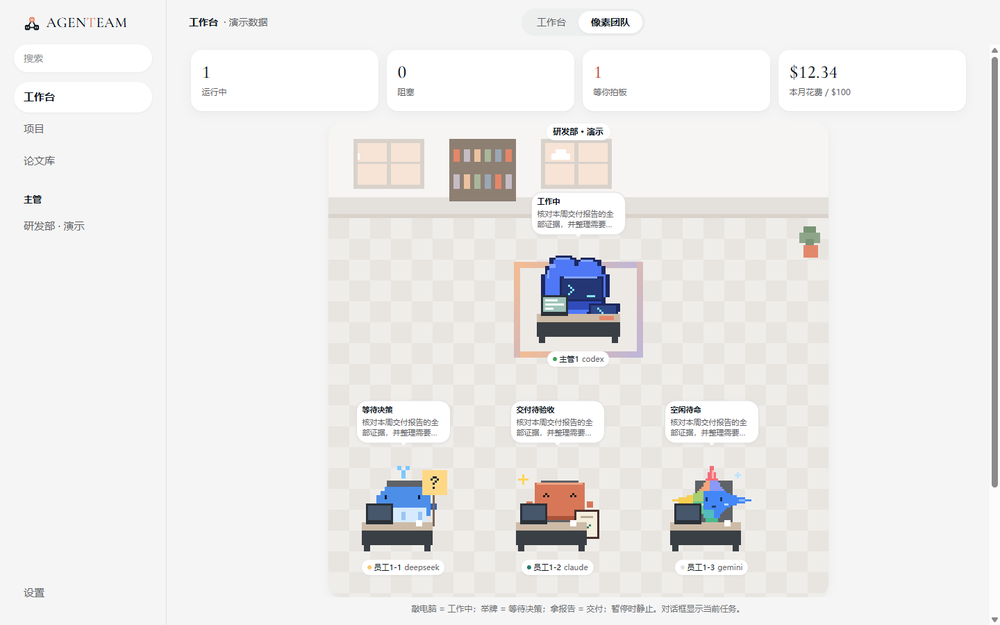
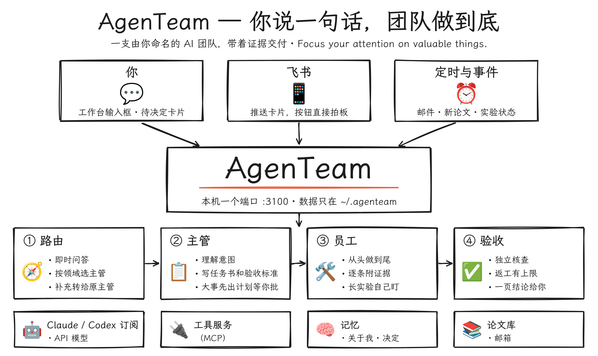

<div align="center">


# AgenTeam

**把注意力放在真正有价值的事情上 · Focus your attention on valuable things.**

你说一句话就可以离开。一支由你命名的 AI 团队替你从头做到尾，带着证据交付。

**中文** · [English](README.en.md)

[快速开始](#快速开始) · [它怎么工作](#它怎么工作) · [功能](#功能) · [使用手册](docs/guide.md)

[](https://github.com/micsnq2yoma-lgtm/AgenTeam/stargazers) [](https://github.com/micsnq2yoma-lgtm/AgenTeam/actions/workflows/ci.yml)    



</div>

## 它怎么工作

| ① 说一句话 | ② 主管接手 | ③ 员工去做 | ④ 一页结论 |
| --- | --- | --- | --- |
| 路由把事交给最合适的主管 | 理解意图、写验收标准；大事先给你计划 | 本机已登录的 Claude Code / Codex 从头做到尾 | 逐条附证据，主管验收后只给你一页 |

主管和员工都由你命名，没有预设。需要你拍板的事会变成卡片，你不在时可以推送到飞书。

## 适合谁

- ✅ 想把调研、写作、整理这类整件事交出去，而不是一句句盯着对话
- ✅ 已经有 Claude / Codex 订阅，想让它们分工协作
- ✅ 希望每个结论都带证据、有人独立核查
- ❌ 不是多人协作的 SaaS：每台电脑一套，数据只在本机

## 功能

| | |
| --- | --- |
| 🧭 **路由与主管** 一句话派给合适的主管，大事先出计划，你点头再动手 | ✅ **证据与核查** 结构化验收、独立核查员、返工和层数上限，防止跑偏 |
| 👀 **盯守** 长任务自己盯着，到点或出事再叫你 | 🧠 **记忆** 跨项目记忆，空闲时自动整理并提交 |
| 🤖 **多模型** 订阅（Claude / Codex）和任意 API 模型，按员工单独指定，显示价格估算 | 🔌 **工具服务（MCP）** 精选一键安装或自定义，按员工授权 |
| ✉️ **邮箱** 只读邮件、存回复草稿，不替你发送 | 📚 **论文库** arXiv / DOI / PDF 入库，全文检索，员工可用 |
| 💬 **飞书** 长连接，无需公网地址；卡片按钮直接生效 | 🎨 **像素办公室** 每个模型一种像素员工，办公室 / 朝堂皮肤可换 |

## 快速开始

Windows 11，Node 24.11+，pnpm 9.15+，Git。先装好并登录：

- Claude Code：`npm i -g @anthropic-ai/claude-code`，运行 `claude` 登录（主管、路由、核查员都用它）
- Codex（可选）：`npm i -g @openai/codex`，`codex login`

```powershell
git clone https://github.com/micsnq2yoma-lgtm/AgenTeam.git
cd AgenTeam
node scripts\install.mjs
```

脚本会检查环境、安装依赖并构建、做首次配置、启动、安装团队层插件、设置开机自启、在桌面放一个带项目图标的快捷方式（十几分钟）。装完打开 <http://127.0.0.1:3100>，在侧栏“主管”旁边点 **+** 新建第一位主管和员工。

**以后一键启动**：双击桌面上的 **AgenTeam** 图标，没在运行就先启动，就绪后自动在浏览器里打开。想补建或重建快捷方式：`powershell -ExecutionPolicy Bypass -File scripts\create-shortcut.ps1`（桌面和开始菜单各一个，加 `-Remove` 删除）。macOS / Linux 用 `node scripts/launch.mjs`。

多台电脑各装一套，互不依赖：各自登录订阅、配置 API key，数据存在各自本机。

## 更新

设置 → 通用 → 版本与更新，点“检查并更新”：有新版本就在后台更新，页面会显示进度，完成后点“刷新页面”（有员工在干活时会先问你要不要打断）。没有定时自动更新，什么时候更新由你按按钮决定。命令行：

```powershell
node scripts\update.mjs --check   # 有没有新版本
node scripts\update.mjs           # 备份 → 停止 → 拉取 main → 增量构建 → 启动 → 健康检查
```

新版本起不来会自动回退；数据库不自动恢复，备份在 `~/.agenteam/backups/`（留 5 份）。单元测试和完整构建在 Linux 和 Windows 上持续运行。

## 架构

<p align="center"></p>

| 目录 | 内容 |
| --- | --- |
| `apps/console/` | 本地服务：路由、IM、设置、记忆、团队向导、招人审批，以及主管 / 员工用的团队 MCP |
| `plugins/team-layer/` | 团队层插件：返工与跳数上限、卡片、结构化验收、独立核查、盯守、记忆整理 |
| `plugins/im-feishu/` | 飞书通道 |
| `vendor/paperclip/ui/src/agenteam/` | 工作台、主管页、设置等 AgenTeam 界面 |
| `packages/` | `shared` 类型 · `skins` 皮肤 · `pixel-office` 像素员工与办公室渲染 |
| `skills/` `packs/` | 主管 / 员工 / 记忆技能包；新建团队的空白模板 |
| `scripts/` | 启动、安装、更新、验收脚本、中文化工具 |

## 文档

- [使用与开发手册](docs/guide.md)：手动运行、邮箱 / 论文库 / MCP / 模型 / 飞书的配置位置、测试
- [界面设计规范](docs/handoff/design/DESIGN.md) · [像素员工](docs/pixel-employees.md)
- [对 Paperclip 源码的改动](docs/paperclip-changes.md)

## Star History

[](https://star-history.com/#micsnq2yoma-lgtm/AgenTeam&Date)

## 致谢

AgenTeam 站在这些项目的肩膀上。完整的第三方许可见 `NOTICE` 和 `packages/pixel-office/THIRD_PARTY_LICENSES`。

- [Paperclip](https://github.com/paperclipai/paperclip)（MIT，© Paperclip AI）
- [agent-autoloop](https://github.com/KKKKhazix/agent-autoloop)（MIT）
- LobeHub
- MyAgents（AGPL）

## 许可

MIT。详见 `LICENSE`。第三方项目见上方[致谢](#致谢)。
