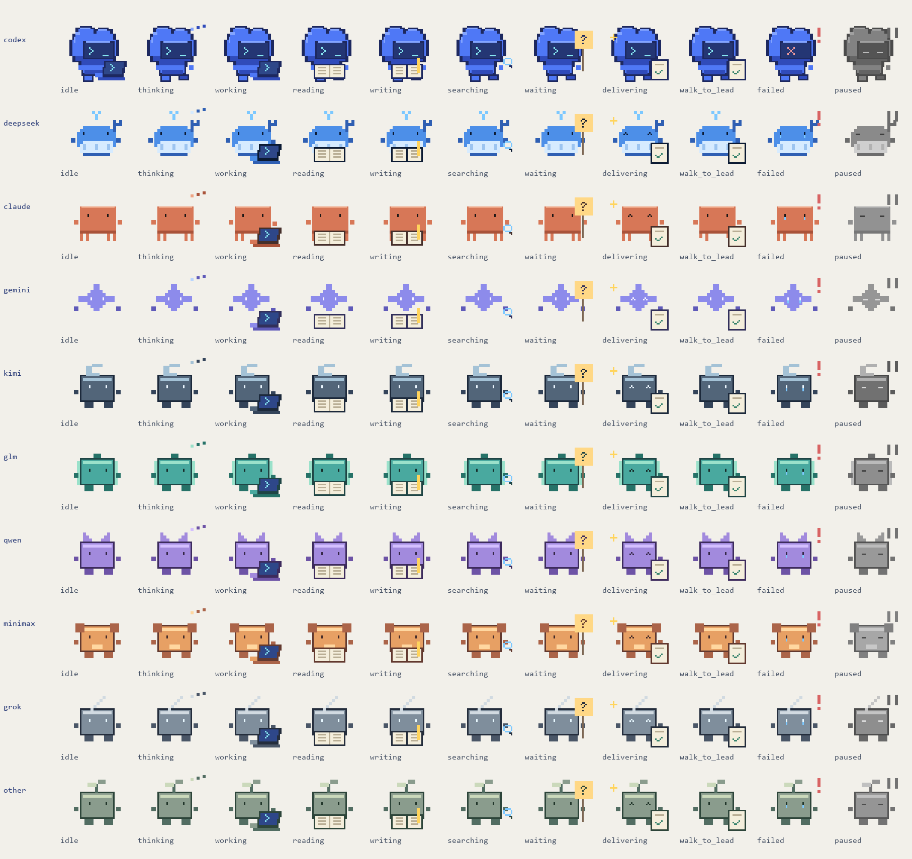

# 像素员工



员工头像和办公室共用 `packages/pixel-office/src/characters.ts`：48×44 整数像素、每个动作 4 帧、240 ms/帧。Codex 按提供的蓝色终端脸宠物重新绘制；DeepSeek 保留提供的 `sprite.ts` 鲸鱼轮廓、腹纹、配色和喷水图案。Claude 是珊瑚色小蟹；Gemini 星星、Kimi 月牙、GLM 书页、Qwen 猫耳、MiniMax 圆耳、Grok 斜光和其他模型的芽苗机器人以轮廓区分。

`modelFamilyFor(adapterType, model)` 先识别已选模型，再在模型为空、`auto` 或 `default` 时回退到适配器。未知的显式模型使用中性形象，避免把兼容接口中的其他模型误认成 Claude。公司上下文变更会清除旧员工注册信息，头像会随模型或状态更新。

| 观测状态 | 展示动作 | 对话框 |
| --- | --- | --- |
| idle | 呼吸、眨眼；Codex 抱着电脑 | 空闲待命 |
| working | 笔记本和交替敲键盘 | 工作中 + 当前任务标题 |
| waiting | 问号牌、轻微晃动 | 等待决策 + 当前任务标题（若有） |
| delivering | 抱报告、跳动和闪光 | 交付待验收 |
| walk_to_lead | 携带报告送给主管、返回工位 | 送交成果 |
| failed | 错误脸/泪滴和红色警示 | 遇到错误 |
| paused | 去色、闭眼、暂停符号，静止 | 已暂停 |

原有 `/office` 状态优先级保留。思考、阅读、编写、搜索四个细分动作也导出供有明确状态的调用方使用；办公室不会根据时间随机假装员工正在执行这些动作。`AgentCharacter` 的显式状态映射到相应动作；没有显式状态时读取员工状态。小头像默认静态，大头像与办公室播放动画。SVG 和 Canvas 都尊重 `prefers-reduced-motion`。

对话框仅展示状态与真实任务标题，标题使用 React 文本转义，长文本两行省略，完整内容保留在标题属性和原有任务详情中。窄屏横向滚动，办公室至少以 2 倍像素比例显示。保留现有员工/任务管理入口，没有新增抚摸、喂食、拖拽或鼠标跟随功能。

## 检查与预览

```sh
pnpm exec vitest run packages/pixel-office/test packages/shared/test apps/console/test/office.test.ts
node scripts/preview-pixel-employees.mjs
```

第二条命令需要 Node 24，在 `work/pixel-preview/index.html` 生成无需联网的被动动画图鉴（演示状态，不连接真实任务）。浏览器打开即可检查全部模型和动作。源素材留在代码中，可以通过 `characterFrame` 导出像素矩形，通过 `characterSvg` / `characterDataUrl` 导出静态或动画 SVG。

版权和来源见 `packages/pixel-office/THIRD_PARTY_LICENSES`。
