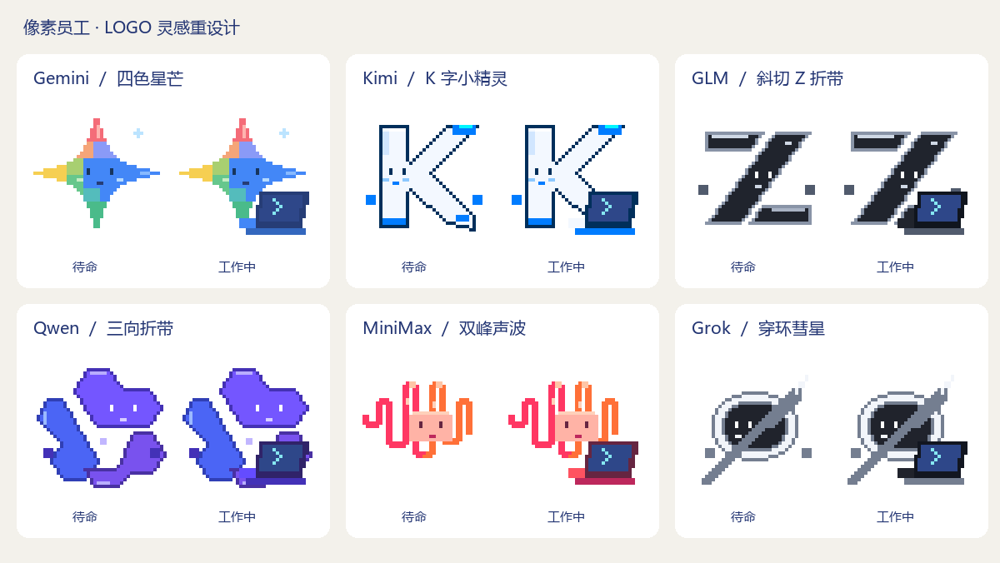

# 像素员工


员工头像和办公室共用 `packages/pixel-office/src/characters.ts`：48×44 整数像素、每个动作 4 帧、240 ms/帧。Codex 按提供的蓝色终端脸宠物重新绘制；DeepSeek 保留提供的 `sprite.ts` 鲸鱼轮廓、腹纹、配色和喷水图案；Claude 是珊瑚色小蟹。这三家已确认的形象和其他模型的中性芽苗形象保持不变。

Gemini、Kimi、GLM、Qwen、MiniMax 和 Grok 从各家官方标志中提取轮廓、配色及负空间，分别设计为非官方原创像素衍生角色。以下链接仅用于记录设计参考；项目不打包官方 LOGO 图片、SVG 或品牌素材，也不表示获得品牌方授权或背书。



| 模型家族 | 像素形象与提取元素 | 官方参考 |
| --- | --- | --- |
| Gemini | 四色弧边四角星；保留向内弯曲的边缘、四个尖角和 Google 蓝、红、黄、绿配色 | [Gemini 视觉设计](https://design.google/library/gemini-ai-visual-design)、[Google 渐变 G 设计](https://blog.google/company-news/inside-google/company-announcements/gradient-g-logo-design/) |
| Kimi | 黑白 K 字轮廓结合品牌蓝；用 K 的竖笔与分叉斜笔形成身体结构 | [Kimi Brand](https://www.kimi.com/en/resources/kimi-brand) |
| GLM | 黑白斜切 Z 折带；取自智谱当前 Z.AI 标志的粗斜笔、上下短横与平行斜缝 | [智谱官网](https://www.zhipuai.cn/en)、[官网 Z.AI 标志](https://www.zhipuai.cn/logo-en.svg) |
| Qwen | 蓝紫三向折带；保留官网标志向三个方向展开的折带轮廓与中央负空间 | [Qwen 官网](https://qwen.ai/) |
| MiniMax | 粉橙连续双峰声波；保留两个高拱峰、圆头回环与竖向沟槽，主色参考 `#FF3763` 至 `#FF7038` | [MiniMax Brand Book](https://www.minimax.cn/brand-vi)、[官方标志](https://filecdn.minimax.chat/public/brand-vi/20260914/logo-1.webp) |
| Grok | 黑白圆环加穿环斜线；保留断开的粗圆环、中空结构及左下至右上伸出圆周的尖端 | [官方品牌页](https://x.ai/legal/brand-guidelines)、[官网链接的官方应用图标](https://play.google.com/store/apps/details?id=ai.x.grok) |

`modelFamilyFor(adapterType, model)` 先识别已选模型，再在模型为空、`auto` 或 `default` 时回退到适配器。未知的显式模型使用中性形象，避免把兼容接口中的其他模型误认成 Claude。公司上下文变更会清除旧员工注册信息，头像会随模型或状态更新。

| 观测状态 | 展示动作 | 对话框 |
| --- | --- | --- |
| idle | 呼吸、眨眼；Codex 抱着电脑 | 空闲待命 |
| working | 笔记本和交替敲键盘 | 工作中 + 当前任务标题 |
| waiting | 问号牌、轻微晃动 | 等待决策 + 当前任务标题（若有） |
| delivering | 抱报告、跳动和闪光 | 交付待验收 |
| walk_to_lead | 携带报告送给主管、返回工位 | 送交成果 |
| failed | 错误脸/泪滴和红色警示 | 遇到错误 |
| paused | 去色、闭眼、暂停符号，静止 | 已暂停 |

原有 `/office` 状态优先级保留。思考、阅读、编写、搜索四个细分动作也导出供有明确状态的调用方使用；办公室不会根据时间随机假装员工正在执行这些动作。`AgentCharacter` 的显式状态映射到相应动作；没有显式状态时读取员工状态。小头像默认静态，大头像与办公室播放动画。SVG 和 Canvas 都尊重 `prefers-reduced-motion`。

对话框仅展示状态与真实任务标题，标题使用 React 文本转义，长文本两行省略，完整内容保留在标题属性和原有任务详情中。办公室根据统计条下方的可视宽度和高度选择 2～4 倍整数缩放；单主管加三名员工的画布为 240×228，去掉末尾多余的一整排留白。窄屏保留横向滚动，多排团队按实际工位增加高度并允许纵向滚动。滚动条固定占位，避免临界宽度时反复缩放；窗口变大或变小时重新测量。

坐姿比原来的桌面基线下移 12 个逻辑像素，椅背先画、人物居中、桌面和显示器最后画，遮住下半身；姓名位于桌脚下方，气泡与上一排姓名在最低 2 倍缩放时也保留间距。原模型素材、状态动画和帧时长不变。保留现有员工/任务管理入口，没有新增抚摸、喂食、拖拽或鼠标跟随功能。


## 检查与预览

```sh
pnpm exec vitest run packages/pixel-office/test packages/shared/test apps/console/test/office.test.ts
node scripts/preview-pixel-employees.mjs
node scripts/acceptance/pixel-office-viewport.mjs
```

第二条命令需要 Node 24，在 `work/pixel-preview/index.html` 生成无需联网的被动动画图鉴（演示状态，不连接真实任务）。浏览器打开即可检查全部模型和动作。源素材留在代码中，可以通过 `characterFrame` 导出像素矩形，通过 `characterSvg` / `characterDataUrl` 导出静态或动画 SVG。

第三条命令使用已安装的 Playwright/Chromium；也可通过 `PLAYWRIGHT_CHROMIUM_EXECUTABLE_PATH` 指定本机 Chrome。它加载真实 Team、皮肤、字标和 CSS，以隔离的模拟 `/office` 检查首屏、气泡间距、窄屏滚动和窗口缩放；报告与截图写到 `work/pixel-office-viewport/`，不读写真实员工或任务。页面外围的统计条与输入框为采用生产样式的演示结构，不能替代完整后端端到端验收。

版权和来源见 `packages/pixel-office/THIRD_PARTY_LICENSES`。
